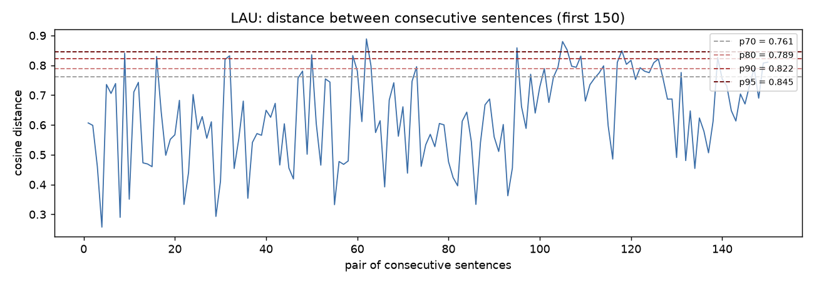
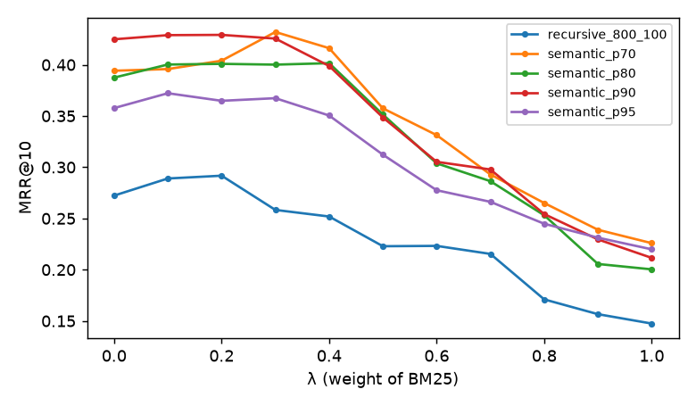

# Fase 3 · Conocimiento: lo que hicimos y por qué

Endpoint: `POST /rag`. Código en [`rag/`](../rag/), tests en
[`tests/test_rag_retrieval.py`](../tests/test_rag_retrieval.py),
[`tests/test_gold.py`](../tests/test_gold.py), [`tests/test_temporal.py`](../tests/test_temporal.py),
[`tests/test_audit_rules.py`](../tests/test_audit_rules.py) y
[`tests/test_download_corpus.py`](../tests/test_download_corpus.py). El detalle de cada paso,
con fechas, está en [EXPERIMENTS.md](../EXPERIMENTS.md).

## 1. Qué aporta esta fase que no hacen las otras dos

La fase 1 congela el conocimiento en los pesos y la fase 2 lo escribe en el código de las
herramientas. Las dos fallan igual cuando la ley cambia, y en este dominio la ley cambia
continuamente. Mientras hacíamos esta fase, el Congreso derogó el RDL 26/2026 a la semana de
publicarse y el RDL 29/2026 reescribió la reducción del IRPF por alquiler. Además, la regla
que se aplica depende de **cuándo** se firmó el contrato.

Por eso la fase tiene dos partes:

1. **El RAG que pide el enunciado**, sobre 52 documentos oficiales. Responde la «cola larga»
   que ninguna herramienta cubre: alquiler de temporada, por habitaciones, seguro de impago,
   plusvalía, IBI de pisos vacíos, pisos turísticos en la comunidad… Responde con citas.
2. **El derecho aplicable en una fecha** (sección 7). Indexamos cada versión de cada artículo
   del BOE con las fechas en que estuvo en vigor, y al responder solo se ven las versiones
   vigentes en la fecha de la pregunta. Con esas mismas versiones, una auditoría comprueba si
   el motor de reglas de las fases 1 y 2 sigue de acuerdo con la ley vigente.

## 2. Corpus

52 documentos y 2,6 millones de caracteres, descargados con un script
([`rag/download_corpus.py`](../rag/download_corpus.py)). Fuentes, licencias y decisiones en
[`rag/CORPUS.md`](../rag/CORPUS.md).

| Fuente | Docs | Cómo |
|---|---|---|
| Leyes consolidadas del BOE (LAU, Ley 12/2023, RDL 29/2026, LIRPF y reglamento, ITP, Catastro, crédito inmobiliario, propiedad horizontal, IBI y plusvalía, IVA) | 11 | API de datos abiertos; un `### Artículo N` por artículo |
| Resoluciones del BOE: sistema de índices de referencia (SERPAVI) y zonas tensionadas | 11 | `diario_boe/xml.php` |
| Manual práctico de Renta 2025 de la AEAT (alquileres e imputación de rentas) | 28 | HTML de la sede, solo el contenido |
| Metodología del IRAV (INE) y folleto hipotecario del Banco de España | 2 | PDF |

Tres decisiones que importan:

- **Versión fijada.** Cada artículo se toma en la versión vigente el 22/11/2026 (`--as-of`), no
  en la última publicada. Así dos descargas dan el mismo corpus y el conjunto dorado no se queda
  apuntando a un texto que ya no existe.
- **Nada derogado.** El script se niega a descargar una ley con `estatus_derogacion = S`. No
  toma por vigente una versión sin fecha: el art. 6 bis del reglamento del IRPF tiene una.
- **Distractores a propósito.** La LIRPF y su reglamento van enteros, aunque la mayor parte no
  trate de alquileres. El 91 % de los fragmentos son del BOE.

## 3. Conjunto dorado

51 preguntas con respuesta y 6 sin ella ([`rag/gold/`](../rag/gold/), formato y criterios en
su [README](../rag/gold/README.md)). Las escribimos leyendo el corpus, con las palabras de quien
compra para alquilar y no con las de la norma: «¿puedo cobrarle los honorarios de la agencia?»,
no «gastos de gestión inmobiliaria».

**Se anota por artículo y cita literal, no por id de fragmento.** Los ids cambian con cada
troceado. [`rag/gold.py`](../rag/gold.py) traduce cada cita a los fragmentos que la contienen
para el troceado que se evalúe, de modo que las mismas preguntas comparan todas las
estrategias. Siete preguntas tienen dos o tres sitios igual de válidos: la amortización del
3 % está en la ley, en el reglamento y en el manual de la AEAT.

**Acierto@k** = la respuesta está entre los k primeros: cualquiera de los fragmentos que tienen
la cita, porque una cita corta suele caber entera en dos fragmentos solapados. Damos también el
`recall@k` de clase (fracción de fragmentos relevantes) y el MRR hasta el puesto 10.

## 4. Troceado



El troceado semántico corta donde la distancia coseno entre frases consecutivas supera un
umbral. La distancia media en nuestro corpus es 0,63: el 0,25 de la docstring cortaría en casi
cada frase. Probamos el umbral en los percentiles 70, 80, 90 y 95. Las frases de más de 1.500
caracteres (las filas de las tablas de zonas tensionadas) se cortan antes por espacios.

<!-- TABLA_TROCEADO: se rellena con reports/phase3_eval.json de la segunda tanda -->

- **El troceado importa más que el retriever.** El recursivo corta artículos por la mitad y
  deja fragmentos de un solo número de apartado («7», «II»). El semántico respeta mejor las
  unidades de la ley.
- **Hay un punto óptimo de tamaño.** Con fragmentos de más de 1.000 caracteres (p95) el vector
  diluye el dato concreto y la recuperación baja.

## 5. Retrievers y λ

Los tres retrievers están en [`rag/retriever.py`](../rag/retriever.py):

- **BM25**, el de la plantilla.
- **Denso**, con Qwen3-Embedding-0.6B. La matriz se guarda en `rag/index/` con un nombre que
  depende del modelo y de cada fragmento: un troceado nuevo tiene su propio fichero y el mismo
  no se embebe dos veces.
- **Híbrido**: `λ·s_bm25 + (1−λ)·s_denso` sobre los 20 primeros de cada uno, con las
  puntuaciones reescaladas a [0, 1].



**λ se elige con validación cruzada:** se elige con la mitad de las preguntas y se puntúa con
la otra mitad, 200 veces. Elegirlo y medirlo sobre las mismas 51 preguntas inflaría el
resultado.

- **El denso gana a BM25 con claridad.** Las preguntas usan las palabras de un inversor y BM25
  no salta de «honorarios de la agencia» a «gastos de gestión inmobiliaria».
- **El híbrido aporta poco y depende del troceado.** Con fragmentos pequeños (p70) mejora al
  denso también en validación cruzada. Con p90 la curva es plana entre λ = 0 y 0,3.
- **Configuración elegida: semántico p90 con λ = 0,2**, en el centro de esa meseta. La meseta
  es más robusta que el pico de p70, y los fragmentos de unos 900 caracteres dan más contexto
  al generador. Con 51 preguntas, la desviación de la validación cruzada (±0,06) es mayor que
  la diferencia entre las configuraciones buenas: no hay un ganador claro y lo decimos.

## 6. La instrucción de la consulta

Qwen3-Embedding embebe la consulta con una instrucción. Probamos seis sobre el troceado p90:

<!-- TABLA_INSTRUCCION: se rellena con reports/phase3_eval.json de la segunda tanda -->

Las genéricas (en inglés, en español o ninguna) quedan empatadas. **Una instrucción de dominio
empeora el MRR un 20 %, igual en inglés que en español: no es el idioma, es el contenido.**
Pedir «el artículo de ley, la norma o el pasaje oficial» empuja los resultados hacia el BOE
(176 de los 255 primeros cinco, frente a 142). Las preguntas que se responden con la AEAT o los
PDF caen de 0,33 a 0,22 de MRR, y las del BOE también bajan, porque las tapan los distractores
de la LIRPF y su reglamento. La instrucción es una palanca real, también en contra.

## 7. Generación con citas

[`rag/generate.py`](../rag/generate.py) recupera los 5 primeros fragmentos, construye el prompt
de clase con ellos y genera con Qwen3-1.7B. Tres cambios sobre la plantilla, cada uno por un
fallo que vimos:

- **La plantilla está en español.** Con la inglesa, el modelo contestaba en inglés la mitad de
  las preguntas.
- **Citas numeradas.** Los pasajes van como [1]…[5] y, después de generar, cada [n] se cambia
  por el id real del fragmento. Un modelo de 1,7B copia «[2]» mucho mejor que
  «[d0a26f8298-0079]», y con ids largos citaba «artículo 36» en su lugar. La comprobación de
  que las citas existen sigue siendo la de la plantilla (`extract_citations`). Además,
  [`rag/eval_generation.py`](../rag/eval_generation.py) cuenta los ids inventados: ninguno en
  ninguna variante.
- **Abstención solo si ningún pasaje trata la pregunta.** Con «si la información no basta,
  dilo», abría respuestas correctas con «no se especifica…».

El «no lo sé» no puede salir de un umbral de similitud. «¿Está Madrid declarada zona
tensionada?» saca 0,75 de similitud con su mejor fragmento, por encima de la media de las
preguntas que sí tienen respuesta (0,66). Lo tiene que decidir el generador, y lo hace: se
abstiene en las 6 preguntas sin respuesta.

<!-- TABLA_GENERACION: base / base con pensamiento / modelo de la fase 1 -->

La abstención se mide aparte según se recuperara o no el fragmento con la respuesta. Si no se
recuperó, decir «no lo sé» es lo correcto.

## 8. El derecho aplicable en una fecha

[`rag/temporal.py`](../rag/temporal.py). El XML consolidado del BOE guarda todas las versiones de
cada artículo. **En una fecha rige la última versión, en el orden del documento, con fecha de
vigencia anterior o igual.** El orden del documento importa por tres casos que aparecen en
nuestro corpus:

- un decreto-ley derogado deja una versión «restaurada» con fecha anterior a otra posterior;
- una reforma ya publicada puede tener fecha futura (art. 85 LIRPF, 2027);
- hay versiones sin fecha.

De cada versión guardamos sus intervalos de vigencia: 2.049 versiones y 8.208 fragmentos.

La fecha se lee de la pregunta («en 2017», «el 10 de enero de 2019», «antes de mayo de 2023»);
si no hay ninguna, se usa la de hoy. Con `ARCA_RAG_TEMPORAL=1`, `/rag` cambia los artículos del
BOE por sus versiones vigentes en esa fecha, deja igual la AEAT, las resoluciones y los PDF,
avisa al modelo de la fecha aplicada y la devuelve en el campo opcional `law_date`.

**17 preguntas con fecha** ([`rag/gold/temporal.jsonl`](../rag/gold/temporal.jsonl)), casi todas
en pares que solo se distinguen por la fecha:

| Pregunta | Una fecha | Otra fecha |
|---|---|---|
| Plazo mínimo del alquiler | 2017: 3 años | 2021: 5 años |
| Plazo mínimo, en torno al RDL 21/2018 (derogado) | 10/01/2019: 5 años | 01/02/2019: 3 años |
| Prórroga tácita | 2016: un año | 2020: hasta tres años |
| Garantía adicional | 2017: sin límite | 2021: dos mensualidades |
| Honorarios de agencia (persona física) | 2021: se podían cobrar | 2024: a cargo del arrendador |
| Reducción del IRPF | renta 2019: 60 % | renta 2024: 90 % (zona tensionada, rebaja > 5 %) |
| Base del ITP | 2020: valor real | 2023: valor de referencia |
| Imputación de pisos vacíos | renta 2025: 2 % | desde 2027: escala del 1,1 % al 3 % |

Siete son de control: su respuesta no ha cambiado, y el RAG normal también debería acertarlas.

<!-- TABLA_TEMPORAL: recuperación hoy / todas / por fecha, y generación -->

### Auditoría del motor de reglas

[`rag/audit_rules.py`](../rag/audit_rules.py) toma cada regla de
[`rlm/realestate_rules.py`](../rlm/realestate_rules.py), el motor del que salen las respuestas
correctas de la fase 1 y las calculadoras de la fase 2. Para cada una compara el artículo
vigente cuando se escribió el motor (septiembre de 2026) con el de hoy, y comprueba que siga
existiendo el texto exacto en que se apoya:

| Estado | Reglas | Qué pasa |
|---|---|---|
| Rota | Las 4 de `rental_reduction_pct` (90/70/60/50 %) | El RDL 29/2026 reescribió el art. 23.2 LIRPF el 8/10/2026; su texto ya no está vigente |
| Revisar | Amortización del 3 % (ley), gran tenedor, +10 % y tope del índice (art. 17 LAU), IVA del 10 % | El artículo cambió, pero el texto en que se apoya la regla sigue ahí |
| Bien | Amortización (reglamento), base del ITP | Sin cambios |

«Rota» quiere decir que el texto de la regla ya no está vigente, no que el motor se equivoque en
todos los casos. Según la disposición transitoria 38.ª, la escala de 2023 sigue valiendo para
contratos firmados hasta el 1/12/2026 ([`docs/fase2.md`](fase2.md), rama `fase2`). La auditoría
avisa; el régimen transitorio lo decide una persona. Es la misma lección que la fase 2 sacó a
mano, convertida en una prueba que se puede repetir cada vez que se descarga el corpus.

## 9. Qué falla y por qué

De las 51 preguntas, 22 no tienen la respuesta entre los 5 primeros con la configuración
elegida. Los fallos se agrupan en cuatro patrones:

- **Los preámbulos tapan a los artículos.** El preámbulo del RDL 29/2026 explica las reglas en
  lenguaje llano («su duración debe superar treinta y un días»), mucho más parecido a la
  pregunta de un inversor que el artículo de la LAU (lau-09, lau-11, aeat-04, ibi-01/02). A
  veces es una respuesta válida que no anotamos, pero un preámbulo no es la norma.
- **Un fragmento «imán».** El caso práctico del manual de la AEAT, una lista larga de gastos
  (IBI, intereses, seguro, amortización), sale el primero en 7 preguntas de IRPF, IBI e IVA.
- **Tablas partidas.** Al cortar las filas largas, el municipio queda separado de su definición
  de gran tenedor (zon-02, zon-03).
- **Vocabulario sin puente.** Para el IVA, el usuario dice «piso usado» y la ley dice «segundas
  y ulteriores entregas de edificaciones»; ningún retriever lo une.

Hay también conflictos reales entre fuentes, marcados en el conjunto dorado: el Manual de Renta
2025 frente a la LIRPF vigente, o el folleto del Banco de España (anterior a 2019, oferta
vinculante de 14 días) frente a la Ley 5/2019 (10 días naturales). Son precisamente los casos que
la sección 8 resuelve con la fecha.

## 10. Cómo reproducirlo

```bash
source smoke/dgx_env.sh                                  # en la DGX: caché de modelos del clúster
uv run python -m rag.download_corpus                     # corpus (~2 min) y versiones de artículos
uv run python -m rag.gold -v                             # comprueba las 51 citas del conjunto dorado
uv run python -m rag.evaluate                            # troceado, retrievers, λ e instrucción (GPU)
uv run python -m rag.eval_generation --name base         # generación con citas (GPU)
uv run python -m rag.eval_temporal                       # derecho en una fecha: recuperación (GPU)
uv run python -m rag.audit_rules                         # auditoría del motor de reglas
```

Configuración de `/rag` (`RagConfig` en [`rag/generate.py`](../rag/generate.py), cada campo con
su variable `ARCA_RAG_*`): troceado semántico con umbral 0,8215, λ = 0,2, Qwen3-Embedding-0.6B,
Qwen3-1.7B sin pensamiento y 512 tokens. `ARCA_RAG_THINKING=1` activa el pensamiento,
`ARCA_RAG_GENERATOR_ADAPTER` carga el modelo de la fase 1 y `ARCA_RAG_TEMPORAL=1` la sección 8. El
generador se carga con la primera pregunta, no en `/health`.
