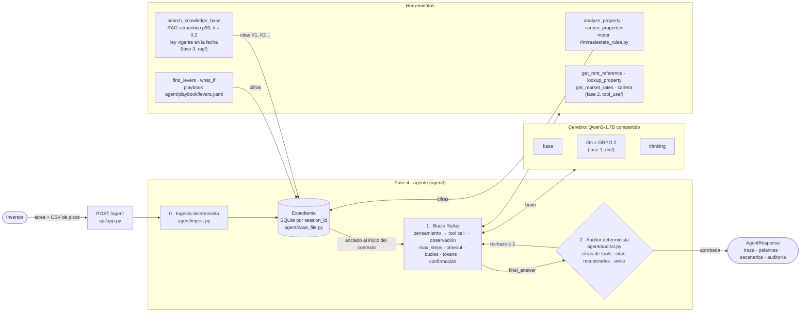

# Umbral · Arquitectura de las cuatro fases

Un solo Qwen3-1.7B, cargado una vez (`api/shared_model.py`), sirve las cuatro fases: el
adaptador de la fase 1 y el modo de pensamiento se eligen en cada petición. El agente de la
fase 4 no aporta un modelo nuevo: junta el modelo de la fase 1, las herramientas de la fase 2
y la base de conocimiento de la fase 3 en un bucle con un expediente y un auditor.

## Qué aporta cada fase

| Fase | Qué es | Dónde entra en el agente |
|---|---|---|
| 1 · Razonamiento | Qwen3-1.7B + LoRA entrenado con SFT y GRPO sobre problemas verificados por el motor | El cerebro `rlm`, que se compara con `base` y `thinking` |
| 2 · Herramientas | El motor de reglas como tools, datos públicos (SERPAVI, zonas tensionadas, Euríbor) y la cartera | Las manos del agente: todas las cifras salen de ellas |
| 3 · Conocimiento | Corpus del BOE y la AEAT, troceado semántico, retriever híbrido y versiones por fecha | `search_knowledge_base`: justifica las palancas con citas |
| 4 · Agente | Bucle ReAct, expediente, playbook de palancas y auditor | `POST /agent` |

## Decisiones

- **El modelo decide qué mirar y el motor pone los números.** El auditor rechaza las cifras que
  no salen de una tool. En la fase 2, el modelo base con tools acertó 20 de 60 problemas del
  test de la fase 1, frente a 1 sin ellas.
- **Un solo bucle, con dos etapas en código (ingesta y auditor).** Así la comparación entre
  cerebros es limpia: solo cambia el cerebro. El multiagente queda como extra.
- **El expediente va anclado al inicio y no se resume nunca.** Evita el efecto «perdido en el
  medio»; lo que se resume son las observaciones antiguas.
- **Descartado: que el RAG descubra las palancas.** Un playbook curado las filtra de forma
  determinista y el RAG solo las justifica. Con 51 preguntas, el RAG recupera el pasaje
  correcto entre los cinco primeros en el 58,8 % de los casos (EXPERIMENTS.md, fase 3): no
  basta para descubrir.
